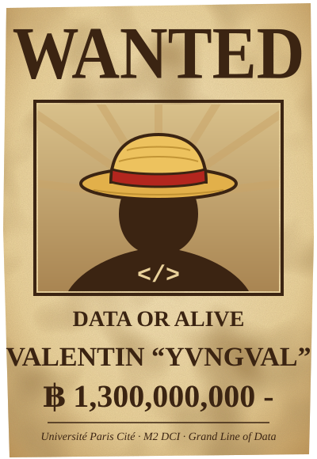

<!-- Header: the open sea -->
<p align="center">
  
</p>

<p align="center">
  
</p>

<p align="center">
  <a href="https://www.linkedin.com/in/valentin-ponnoussamy-ia/"></a>
  <a href="https://u-paris.fr/"></a>
  
</p>

<br />

<table align="center">
<tr>
<td width="42%" align="center" valign="middle">
  
</td>
<td width="58%" valign="middle">

### 🏴‍☠️ Captain's Log

```python
class Pirate:
    name        = "Valentin 'Yvngval'"
    crew        = "Université Paris Cité"
    rank        = "M2 DCI — Données, Connaissances et Intelligence"
    devil_fruit = "Deta Deta no Mi"  # Logia: turns any dataset into insight
    haki        = ["Machine Learning", "Information Retrieval",
                   "Data Privacy", "Full-Stack Web"]
    dream       = "Find the One Piece: a model that explains itself"

    def set_sail(self):
        return "Benchmark everything. Trust nothing unmeasured."
```

</td>
</tr>
</table>

---

## 🗺️ Islands I've Conquered

> *Each project is an arc. Each arc made the crew stronger.*

<table>
  <tr>
    <td width="50%" valign="top">
      <h3>⛓️ Impel Down Arc</h3>
      <p><a href="https://github.com/Yvngval/TER_Project"><b>TER — Anonymize, then attack</b></a><br />
      Lock the data in the deepest prison, then try to break it out: a <b>privacy–utility benchmark</b> with ARX, re-identification and membership inference attacks.</p>
      
      
      
    </td>
    <td width="50%" valign="top">
      <h3>🔧 Water 7 Arc</h3>
      <p><a href="https://github.com/Yvngval/Predictive-Maintenance-Explainable-ML"><b>Explainable Predictive Maintenance</b></a><br />
      Know the ship will break <i>before</i> it sinks. Logistic regression, Random Forest and <b>XGBoost</b> on AI4I 2020, compared on PR-AUC and explained with <b>SHAP</b>.</p>
      
      
      
    </td>
  </tr>
  <tr>
    <td width="50%" valign="top">
      <h3>🧭 Log Pose Arc</h3>
      <p><a href="https://github.com/Yvngval/Project-ANN-Comparative-Method"><b>ANN Search Benchmark</b></a><br />
      Find the nearest island among a million: <b>HNSW vs IVF-PQ vs LSH</b> on SIFT1M with FAISS, plus a PCA compression study.</p>
      
      
    </td>
    <td width="50%" valign="top">
      <h3>🪨 Poneglyph Arc</h3>
      <p><a href="https://github.com/Yvngval/Data_Science_Project"><b>Kaggle Search Engine</b></a><br />
      Decipher the ancient texts: <b>TF-IDF, BM25+ and Sentence Transformers</b>, with category reranking and rank fusion.</p>
      
      
      
    </td>
  </tr>
  <tr>
    <td width="50%" valign="top">
      <h3>📚 Ohara Arc</h3>
      <p><a href="https://github.com/Yvngval/ASADI-Assistant"><b>ASADI — AI Study Assistant</b></a><br />
      The island of scholars: my bachelor's final project, an <b>AI educational assistant</b> using RAG & LLMs for document-based learning.</p>
      
      
    </td>
    <td width="50%" valign="top">
      <h3>🫧 Sabaody Arc</h3>
      <p><a href="https://github.com/Yvngval/Projet_Web"><b>Full-Stack Event Manager</b></a><br />
      Where every crew meets: React frontend, <b>two interchangeable REST backends</b> (Django REST Framework & Express) and JWT role-based auth.</p>
      
      
      
    </td>
  </tr>
</table>

<details>
  <summary><b>🏝️ Side quests (filler arcs, but canon)</b></summary>
  <br />

| Arc | Project | What it is | Stack |
|---|---|---|---|
| ⚖️ Enies Lobby | [Projet_RCR](https://github.com/Yvngval/Projet_RCR) | Solver for Dung argumentation frameworks (stable & preferred semantics) | Python |
| 🩺 Drum Island | [Survival-data-analysis](https://github.com/Yvngval/Survival-data-analysis) | Five-year breast cancer survival on Haberman's dataset, with clustering | R · ggplot2 |
| 🎲 Long Ring Long Land | [Quoridor-Project](https://github.com/Yvngval/Quoridor-Project) | The Quoridor board game | Python |
| 🗄️ The ship's hold | [mini-SGBD](https://github.com/Yvngval/mini-SGBD) | A minimal database management system | — |

</details>

---

## ⚔️ The Crew's Arsenal

<p align="center">
  <b>🗣️ Languages of the seas</b><br /><br />
  
</p>

<p align="center">
  <b>🔮 Devil fruits (Data & ML)</b><br /><br />
  
  
  
  
  
  
  
  
</p>

<p align="center">
  <b>⚓ Shipwright tools (Web & Tools)</b><br /><br />
  
</p>

---

## 🌊 Bounty Board

<p align="center">
  
  
</p>

<p align="center"><b>🐉 A Sea King devouring my contributions</b></p>

<p align="center">
  <picture>
    <source media="(prefers-color-scheme: dark)" srcset="https://raw.githubusercontent.com/Yvngval/Yvngval/output/github-contribution-grid-snake-dark.svg" />
    
  </picture>
</p>

---

<p align="center">
  <i>“The One Piece is real… and it's well-documented code.”</i><br /><br />
  ⭐ Drop a star if you'd join the crew!
</p>

<!-- Footer: the sea again -->
<p align="center">
  
</p>
